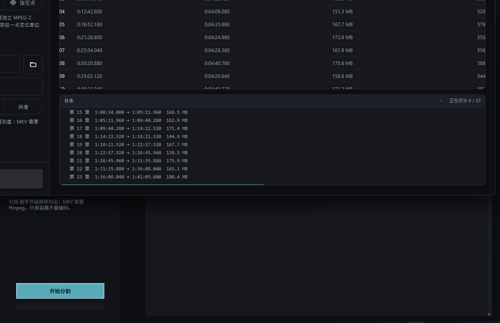
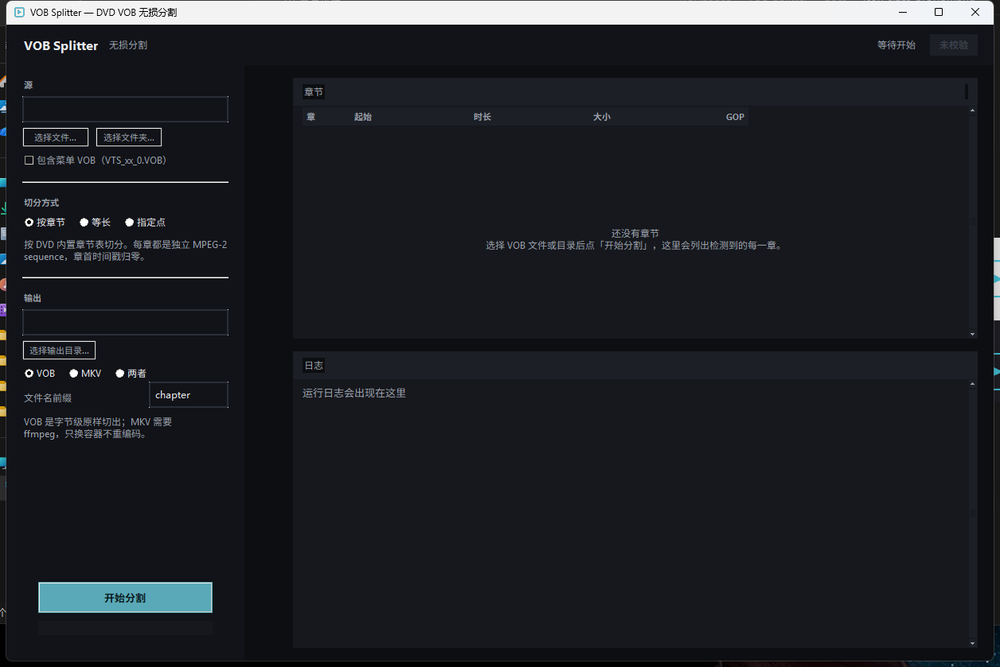
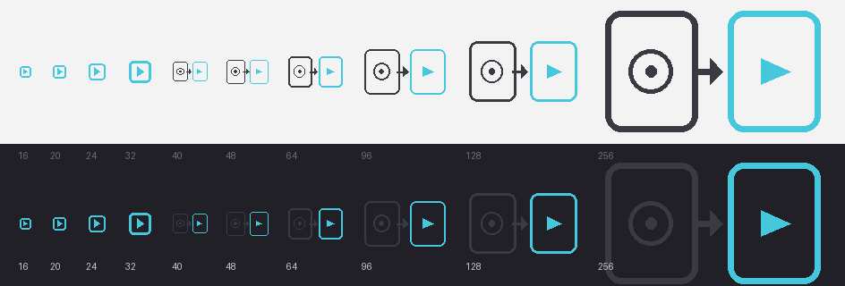
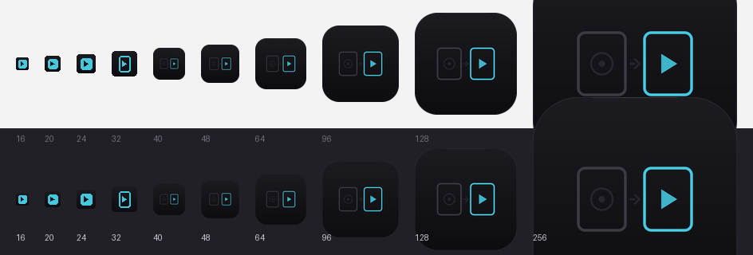

# VOB Splitter

**DVD VOB 无损分割工具 —— 按章节切开，逐字节不差。**
**Lossless DVD VOB splitter — cut by chapter, byte for byte.**

[](LICENSE)
[](python/)
[](flutter/)

> 市面上没有现成软件能做到「按 DVD 章节切 VOB 且 100% 无损」。
> 常见做法是重新编码（画质掉一档）或用粗粒度一刀切。
> 这个工具只做**字节级切片** —— 输出的每一个字节都来自原始码流。

---

## 它做什么

给一张 DVD（或一份 VOB 文件），按章节把它切成多个文件，**不重新编码、不重新封装**，
并给出可复核的哈希证据。

```
VTS_01_1.VOB ┐
VTS_01_2.VOB ├─ 一条连续的 MPEG-2 PS 码流 ──▶ chapter_01.vob
VTS_01_3.VOB ┤                                   chapter_02.vob
VTS_01_4.VOB ┘                                   ... chapter_23.vob
```

## 怎么做到的（30 秒版）

DVD 的每一章都是**一条独立的 MPEG-2 sequence**，章首会把时间戳（PTS）归零。
所以在码流里「**PTS 回落**」就精确对应一个章边界，而且那个位置天然是一个
随机访问点（序列头 + I 帧），可以安全切入 —— 于是：

* 切点 = 码流里 PTS 回落的那个 pack 边界
* 输出 = 输入码流的一段**连续字节**，原样复制
* 校验 = 源流 SHA-256 与「各章拼接 SHA-256」逐位比对

细节见 [`docs/ALGORITHM.md`](docs/ALGORITHM.md)。

---

## 两套实现

| 目录 | 形态 | 依赖 | 适合 |
|---|---|---|---|
| [`python/`](python/) | **CLI + 桌面 GUI** | Python 3.8+，**零第三方依赖**（GUI 用标准库 Tkinter） | 脚本、批处理、服务器、想要个双击就能用的窗口 |
| [`flutter/`](flutter/) | **桌面 GUI + 纯 Dart 核心库** | Flutter 3.16+ / Dart 3.4+ | 想要跨平台一致性更好的桌面应用 |

两套实现**完全独立**：各自的核心算法、CLI、图形界面、测试都在自己的目录里，
互不依赖，但**行为一致** —— 核心算法逐行对应，测试用例一一对应。
`tools/cross_check.py` 会让两边跑同一个 VOB，逐项比对 scan 结果、切分产物哈希与 manifest。

### 图形界面

两边的图形界面同构：左侧控制栏（源 / 切分方式 / 输出），右侧章节表格 + 日志，
顶栏是状态与**无损校验**徽章。



* Python 版：`python -m vobsplit.gui`（Tkinter，纯标准库，不用装任何东西）
* Flutter 版：`cd flutter/app && flutter run -d windows`

---

## 快速开始

没有 DVD 也能先试 —— 造一个结构一致的多章节样例：

```bash
python tools/make_sample_vob.py sample.vob 5 30   # 5 章，每章 30 秒
python -m vobsplit split sample.vob -o ./out      # 切分并自动校验
```

真实 DVD：

### Python

```bash
cd python
python -m vobsplit scan  "D:\VIDEO_TS"          # 先看看能切出几章
python -m vobsplit split "D:\VIDEO_TS" -o "D:\Split"
python -m vobsplit.gui                          # 图形界面
```

### Flutter（桌面 GUI）

```bash
cd flutter/app
flutter pub get
flutter run -d windows      # 或 macos / linux
```

### 纯 Dart（不想装 Flutter 也能用）

```bash
cd flutter/packages/vobsplit_core
dart pub get
dart run bin/vobsplit.dart split "D:\VIDEO_TS" -o "D:\Split"
```

---

## 命令行

```
python -m vobsplit scan   VOB... [--json]
python -m vobsplit split  VOB... -o OUTDIR [选项]
python -m vobsplit verify OUTDIR --source VOB...
```

| 选项 | 说明 |
|---|---|
| `--mode auto` | 按 DVD 内置章节切（默认） |
| `--mode duration` | 每 `--interval` 秒切一段 |
| `--mode times` | 按 `--times "0,218,489.28"` 指定切点 |
| `--times` | 支持 `90` / `1:30` / `00:01:30.5` / `1h2m3s` |
| `--interval` | 等长切分的间隔秒数 |
| `--min-chapter` | 短于该秒数的章视为噪声并合并（默认 2.0） |
| `--pts-drop` | 判定 PTS 回落的阈值（默认 1.0 秒） |
| `--format vob\|mkv\|both` | 输出形式；mkv 需要 ffmpeg |
| `--ffmpeg PATH` | 指定 ffmpeg 位置 |
| `--no-verify` | 跳过 SHA-256 校验（不推荐） |
| `--include-menu` | 展开目录时把 `VTS_xx_0.VOB` 菜单文件也算进去 |

输入可以是单个 `.vob`、一个目录、或多个 `.vob`。
DVD 会把一个标题切成 `VTS_xx_1..5.VOB`（每个上限 1 GiB），它们在码流上连续，工具按一条流处理。

---

## 打包成 Windows 程序

Python 版可以用 PyInstaller 打成**目录版** exe（刻意不用单文件版，理由见
[`python/README.md`](python/README.md)）：

```bash
cd python
pip install pyinstaller
python build_exe.py --with-cli
```

产物是 `python/dist/vobsplit\vobsplit.exe` + 一个 `_internal\` 依赖目录，
双击即用，也可以整个文件夹拷给任何人。



### 图标

两套实现各一套图标，都按尺寸分别绘制（小尺寸另画简化版，不是缩放出来的）：

* **Python 版**（透明底字形，贴在应用自己的深色标题栏 / 任务栏上）：
  
* **安装程序**（带深色圆角底板，在资源管理器、「应用和功能」里独立显示）：
  

生成脚本：`tools/build_python_icon.py`（应用图标）、`tools/build_setup_icon.py`（安装程序图标）。

## 安装包

两套实现各有一个 Windows 安装包脚本，产物都进 `release/`：

| 实现 | 打包器 | 脚本 | 需要的工具 |
|---|---|---|---|
| Python | **Inno Setup** | [`python/installer/vobsplit.iss`](python/installer/vobsplit.iss) | Inno Setup 6 或 7 |
| Flutter | **NSIS** | [`flutter/app/installer/vobsplit.nsi`](flutter/app/installer/vobsplit.nsi) | NSIS 3.x |

一键构建：

```bash
python tools/build_installers.py python            # PyInstaller → ISCC
python tools/build_installers.py python --chinese  # 同上，安装界面为中文
python tools/build_installers.py flutter           # flutter build windows → makensis
python tools/build_installers.py all
```

* **Inno**：装到 `{autopf}\VOB Splitter`，带开始菜单/桌面快捷方式、卸载项、
  Windows 版本信息；`[Files]` 收的是**目录版**产物（exe + `_internal\`）。
  图形界面装在根目录，命令行版装在 `cli\`（打过 `--with-cli` 时才存在）。
  默认英文界面；系统装有 Inno 的 SimplifiedChinese 语言包时，`--chinese`
  可生成中文版安装包。
* **NSIS**：装到 `$PROGRAMFILES64\VOB Splitter`，**界面是自绘的** ——
  不用 NSIS 默认那套 MUI2 窗口，而是由一个 Duilib 插件把整个界面画出来：

  | 位置 | 是什么 |
  |---|---|
  | [`flutter/app/installer/plugin/VobSkin.cpp`](flutter/app/installer/plugin/VobSkin.cpp) | NSIS 插件：拉起 Duilib 窗口、转发控件操作、回调 NSIS 脚本 |
  | [`flutter/app/installer/skin/setup.xml`](flutter/app/installer/skin/setup.xml) | 安装界面布局（Duilib XML） |
  | [`flutter/app/installer/skin/uninstall.xml`](flutter/app/installer/skin/uninstall.xml) | 卸载界面布局（同一套视觉） |
  | [`flutter/app/installer/skin/assets/`](flutter/app/installer/skin/assets) | 自绘位图：应用图标（按小尺寸重处理过的光盘）、复选框、最小化/关闭、对勾徽章、进度条前景 |
  | `flutter/app/installer/third_party/duilib/` | 内嵌的 Duilib 源码（MIT + BSD，见该目录下的 LICENSE） |

  生成 `uninstall.exe`，写标准 `Uninstall` 注册表项，可在「应用和功能」里正常卸载。
  **卸载界面也是自绘的**（确认 → 进行中 → 完成三页），和安装界面同一套视觉；
  静默卸载（`uninstall.exe /S`）不走界面，删除动作由卸载段补上。

> **NSIS 这一侧要编两样东西**，顺序不能反：
> ```bash
> cd flutter\app && flutter build windows --release
> python installer\plugin\build_plugin.py     # 编译 Duilib 皮肤插件（需要 VS 的 C++ 工具链）
> ```
> 皮肤位图改了的话再跑一次 `python tools\build_skin_assets.py`。

> **插件必须常驻**。NSIS 默认每次插件调用结束就卸载插件，于是每次调用都是一个
> 全新模块实例 —— 窗口建在一个实例里，后面的 `SetSkinCaption` / `BindSkinCallback`
> 全落在另一个实例上，表现就是标题改不了、按钮点了没反应。
> 脚本里用 `SetPluginUnload alwaysoff` 解决。
> 卸载器是另一个 exe，这招不一定管用，所以卸载流程整个放进**一次**插件调用
> （`VobSkin::RunUninstallSkin`）里，不依赖插件跨调用常驻。

---

## 校验：怎么证明「无损」

每次运行都会写一个 `vobsplit-manifest.json`：

```json
{
  "source_bytes": 3872296960,
  "source_sha256": "67c9d715...3bd3",
  "output_bytes": 3872296960,
  "output_sha256": "67c9d715...3bd3",
  "verified": true,
  "chapters": [
    {
      "file": "chapter_01.vob",
      "start_offset": 0,
      "end_offset": 138842112,
      "bytes": 138842112,
      "rap_count": 455,
      "duration": 217.88
    }
  ]
}
```

`source_sha256 == output_sha256` 且字节数相等 ⇒
**输出的每一个字节都来自输入**，没有重编码、没有重封装、没有丢帧。

随时可以自己复核：

```bash
python -m vobsplit verify "D:\Split" --source "D:\VIDEO_TS"
```

### 真盘实测

在一张真实 DVD（NTSC，720×576 / 25fps / MPEG-2 + 双 AC-3，无字幕，01:40:59）上跑：

```
源: VTS_01_1~4.VOB  3,872,296,960 字节
pack=1,890,770   非法 pack=0   视频 PES=1,733,871   随机访问点=12,638
检测到 23 章
源 SHA-256 = 67c9d715ef3ccc0c4afe1b8b915e766353b2e4fa9ff9b5a7619139111bff3bd3
出 SHA-256 = 67c9d715ef3ccc0c4afe1b8b915e766353b2e4fa9ff9b5a7619139111bff3bd3
→ 逐字节完全一致
```

每章时长与 DVD 内置章节表（PGC program map）逐项吻合，**最大偏差 0.48 秒 = 一个 GOP**
（因为章内时长是从首 GOP 起点量到末 GOP 起点，不含末个 GOP 的长度）。

---

## 已知边界

* **CSS 加密盘**：码流本身是密文，本工具只切片不解密；输出与输入同为密文，切点判定会失效。
* **没有章节表的 VOB**：`auto` 模式检测不到边界时，工具会提示改用 `duration` / `times`。
* **转 MKV 会丢导航包**：DVD 的 PCI/DSI 导航包装不进 Matroska 容器被丢弃，
  它与音视频码流无关，不影响播放与画质。

---

## 贡献

见 [CONTRIBUTING.md](CONTRIBUTING.md)。新增功能请同时补 Python 与 Dart 两边的测试。

## License

[MIT](LICENSE)
