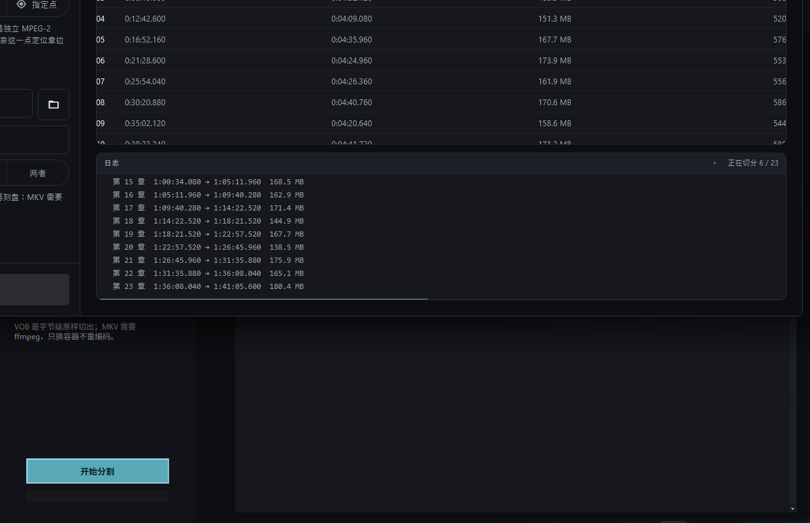

# vobsplit (Python)

DVD VOB 无损分割工具的 Python 实现。**零第三方依赖**，只用标准库
（图形界面用标准库的 Tkinter）。

```bash
python -m vobsplit scan  "D:\VIDEO_TS"
python -m vobsplit split "D:\VIDEO_TS" -o "D:\Split"
python -m vobsplit.gui        # 图形界面
```

也可以安装成命令：

```bash
pip install -e .
vobsplit split "D:\VIDEO_TS" -o "D:\Split"
vobsplit-gui                  # 图形界面
```

## 图形界面

Tkinter 实现，和 Flutter 版同构：左侧控制栏（源 / 切分方式 / 输出），
右侧章节表格 + 日志，顶栏是状态与「无损校验」徽章。切分跑在后台线程里，界面不卡。



## 打包成 Windows 程序

```bash
cd python
pip install pyinstaller
python build_exe.py                # 只打图形界面
python build_exe.py --with-cli    # 同时打一个命令行版
python build_exe.py --clean-only  # 清理构建产物
```

产物在 `python/dist/`：

```
dist/
├─ vobsplit/         vobsplit.exe  (窗口版，双击即用)
│  └─ _internal/     依赖文件（可逐文件审计）
└─ vobsplit-cli/     vobsplit-cli.exe (命令行版)
```

### 为什么刻意不用单文件（--onefile）

* 单文件版每次运行都会把整个包解压到 `%TEMP%\_MEIxxxxx` 再执行 ——
  解压出来的临时目录同样会被执行，注入面比普通目录大得多；
* 单文件是一个自解压 blob，**没法逐文件审计**，内部 dll 也没法单独签名；
* 目录版是正常的文件夹结构，一眼能看清带了什么，可以按文件做白名单和哈希校验。

打包脚本里有一道断言：产物必须是「目录 + 多个文件」，否则直接中止，
避免有人后来手滑改回 `--onefile`。

打包完可以这样验一下：

```bash
python tools/verify_exe.py   # 真的启动 exe 并截图
```

### 打成安装包（Inno Setup）

```bash
# 需要 Inno Setup 6 或 7（ISCC.exe）
iscc installer\vobsplit.iss
# 或走统一入口：
python ..\tools\build_installers.py python
# 中文安装界面（需系统装有 Inno 的 SimplifiedChinese 语言包）：
python ..\tools\build_installers.py python --chinese
```

安装包会把**目录版**产物（`vobsplit.exe` + `_internal\`）一起装到
`{autopf}\VOB Splitter`，带开始菜单/桌面快捷方式、卸载项与 Windows 版本信息。
命令行版（`vobsplit-cli.exe`）装在同目录的 `cli\` 下。

> Inno 的相对路径是相对**脚本所在目录**（`python\installer\`）解析的，
> `NOTICE.txt` 必须和 `.iss` 放在一起。

安装程序自己的图标是 `python\assets\vobsplit-setup.ico`（深色底板的双帧字形，
与应用自身的透明底图标分开）。重新生成：`python ..\tools\build_setup_icon.py`。

## 命令

```
vobsplit scan   VOB... [--json]
vobsplit split  VOB... -o OUTDIR [选项]
vobsplit verify OUTDIR --source VOB...
```

| 选项 | 默认 | 说明 |
|---|---|---|
| `--mode` | `auto` | `auto` 按 DVD 章节 / `duration` 等长 / `times` 指定点 / `whole` 不切 |
| `--times` | — | 切点，如 `0,218,489.28`、`00:01:30.5`、`1h2m3s` |
| `--interval` | `600` | 等长切分的间隔秒数 |
| `--min-chapter` | `2.0` | 短于该秒数的章并入上一章 |
| `--pts-drop` | `1.0` | 判定 PTS 回落的阈值（秒） |
| `--format` | `vob` | `vob` / `mkv` / `both`（mkv 需要 ffmpeg） |
| `--ffmpeg` | 自动查找 | ffmpeg 可执行文件路径 |
| `--prefix` | `chapter` | 输出文件名前缀 |
| `--no-verify` | 关 | 跳过 SHA-256 校验 |
| `--include-menu` | 关 | 展开目录时把 `VTS_xx_0.VOB` 也算进去 |

## 输入

* 单个 `.vob`
* 一个目录（自动展开其中的 `.vob`，按 `VTS_xx_N` 数字排序）
* 多个 `.vob`（DVD 把一个标题切成 `VTS_xx_1..5.VOB`，码流上连续，按一条流处理）

## 输出

* `chapter_01.vob` … 每章一个，字节级原样切出
* `vobsplit-manifest.json` —— 含源流/出流 SHA-256 与每章的字节区间

## 测试

```bash
cd python
python -m unittest discover -s tests -v
```

测试用合成 VOB（不依赖真实光盘），覆盖时间戳往返、章节检测、切点对齐、
字节级无损、多文件源、等长/指定点模式等。

## 原理

见 [`../docs/ALGORITHM.md`](../docs/ALGORITHM.md)。
